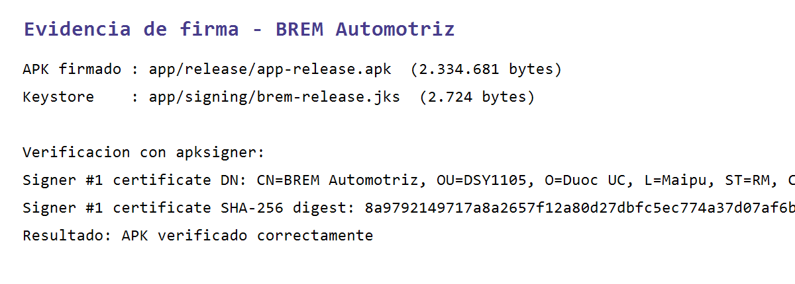

# BREM Automotriz

Cliente Android de órdenes de trabajo (OT) del taller BREM Automotriz, Maipú.
Proyecto de Desarrollo de Aplicaciones Móviles (DSY1105), Duoc UC.

La aplicación es un cliente REST con arquitectura MVVM: consume el servicio del
taller desplegado en `http://52.6.72.225:9090` y el servicio público de
indicadores económicos `https://mindicador.cl`. El servidor calcula neto, IVA y
total de cada orden; la app muestra esos valores, no los recalcula.

## Integrantes

- Yuliana Calvucura
- Catalina Salinas

Sección: DESARROLLO DE APLICACIONES MOVILES_012D.

## Funcionalidades

- Pantalla de splash con el logo de BREM al abrir la app.
- Inicio de sesión contra `/auth/login`; el token JWT se guarda en DataStore
  Preferences y se envía como `Authorization: Bearer <token>` en las llamadas
  al backend del taller.
- Cierre de sesión local: el token se elimina del dispositivo y se vuelve a la
  pantalla de login. La expiración del token también fuerza el cierre de sesión.
- Home con el nombre y rol de la persona autenticada. Muestra UF y dólar
  obtenidos desde mindicador.cl; si ese servicio falla, solo se afecta la
  tarjeta de indicadores.
- Búsqueda de órdenes por patente, cliente o número de OT, con consulta al
  backend al escribir y opción de reintentar.
- Creación de órdenes: busca la patente en `/vehiculos/patente/{patente}`; si no
  existe, permite registrar cliente y vehículo antes de crear la OT.
- Detalle de la OT: trabajos y repuestos (líneas), evidencias, historial real
  de cambios de estado y resumen para compartir con otras apps.
- Edición de la observación de ingreso mediante `PUT /ordenes/{id}`.
- Cambio de estado mediante `PATCH /ordenes/{id}/estado`. Las órdenes nunca se
  eliminan: solo pueden anularse (`ANULADA`). Para marcar `ENTREGADO` se exige
  una observación de entrega.
- Administración de clientes y vehículos con alta, consulta, edición (`PUT`) y
  listado. En la edición de vehículos se puede cambiar el cliente asociado.
- Roles `ADMIN` y `JEFE`: pueden avanzar estados y anular órdenes. Los estados
  finales son `ENTREGADO` y `ANULADA`; sobre ellos no se permiten más cambios.
- Fotos del vehículo con la cámara del dispositivo: se guarda la ruta local como
  texto en la evidencia; este proyecto no implementa subida de archivos.

## Endpoints utilizados

### Backend del taller

Base URL por defecto: `http://52.6.72.225:9090`.

| Método | Ruta | Uso en la app |
|---|---|---|
| `POST` | `/auth/login` | Inicio de sesión y obtención del token JWT |
| `GET` | `/clientes` | Listado de clientes |
| `POST` | `/clientes` | Crear cliente |
| `PUT` | `/clientes/{id}` | Editar cliente |
| `GET` | `/vehiculos` | Listado de vehículos |
| `GET` | `/vehiculos/patente/{patente}` | Buscar vehículo por patente |
| `POST` | `/vehiculos` | Crear vehículo |
| `PUT` | `/vehiculos/{id}` | Editar vehículo |
| `GET` | `/ordenes/buscar?q={texto}` | Buscar órdenes de trabajo |
| `GET` | `/ordenes/{id}` | Detalle de una orden |
| `POST` | `/ordenes` | Crear orden de trabajo |
| `PUT` | `/ordenes/{id}` | Actualizar observación de ingreso |
| `PATCH` | `/ordenes/{id}/estado` | Cambiar estado / anular / entregar |
| `GET` | `/ordenes/{ordenId}/lineas` | Líneas de trabajo y repuestos |
| `POST` | `/ordenes/{ordenId}/lineas` | Agregar línea |
| `PUT` | `/ordenes/{ordenId}/lineas/{lineaId}` | Editar línea |
| `DELETE` | `/ordenes/{ordenId}/lineas/{lineaId}` | Eliminar línea |
| `POST` | `/ordenes/{ordenId}/evidencias` | Registrar evidencia (ruta local) |
| `GET` | `/ordenes/{ordenId}/historial` | Historial de cambios de estado |

El gateway inyecta las cabeceras `X-User-*` desde el JWT, por lo que la app no
las envía. No hay endpoints de eliminación de órdenes ni de logout remoto.

### mindicador.cl

Cliente Retrofit independiente, sin token:

- `GET https://mindicador.cl/api/uf`
- `GET https://mindicador.cl/api/dolar`

Se usa el primer elemento de `serie` como valor vigente.

## Tecnologías

Kotlin, Jetpack Compose, Material 3, MVVM, Navigation Compose, Retrofit,
OkHttp, Gson, DataStore Preferences, Coroutines y Flow, JUnit, MockK, JaCoCo.
No se utiliza Room: el estado remoto se obtiene y modifica desde la API REST.

## Cómo ejecutarla

1. Clonar el repositorio y abrir la carpeta en Android Studio.
2. Usar JDK 21 y esperar a que termine la sincronización de Gradle. Si el SDK no
   se detecta automáticamente, crear `local.properties` con `sdk.dir` apuntando
   al SDK de Android.
3. Ejecutar en emulador o dispositivo con Android 8.0 o superior (API 26).

La URL del backend se compila en `BuildConfig.BASE_URL`. El valor por defecto es
`http://52.6.72.225:9090`. Para apuntar a otro servidor, pasar la propiedad
`backendHost` al compilar:

```powershell
.\gradlew :app:assembleDebug -PbackendHost=http://10.0.2.2:9090
```

El manifiesto solicita `android.permission.INTERNET` y usa
`network_security_config.xml`, que habilita tráfico HTTP en texto plano solo
para `52.6.72.225` y `10.0.2.2`. No hay configuración global de
`usesCleartextTraffic`.

Las credenciales de acceso se obtienen del servicio de autenticación del
backend; este repositorio no incluye cuentas ni contraseñas de prueba.

### Compilación y firma release

La configuración de firma lee las propiedades desde `keystore.properties`
(`storeFile`, `storePassword`, `keyAlias`, `keyPassword`), archivo que no debe
subirse con valores reales a un repositorio público. El keystore generado para
este proyecto está en `app/signing/brem-release.jks`.

```powershell
.\gradlew :app:assembleRelease
```

El APK firmado se copia además a `app/release/app-release.apk`. La firma se
verificó con `apksigner verify --print-certs`; el certificado queda identificado
como `CN=BREM Automotriz, OU=DSY1105, O=Duoc UC, L=Maipu, ST=RM, C=CL`.



## Pruebas y cobertura

```powershell
.\gradlew :app:testDebugUnitTest
.\gradlew :app:assembleRelease :app:lintDebug :app:jacocoTestReport :app:jacocoTestCoverageVerification
```

- `testDebugUnitTest`: 44 pruebas, 44 correctas.
- `assembleRelease`: correcto, APK firmado y copiado a `app/release`.
- `lintDebug`: correcto, 0 errores (26 advertencias informativas).
- `jacocoTestCoverageVerification`: correcto, umbral mínimo del 80 % superado.

Cobertura real sobre ViewModels, repositorios y dominio (instrucciones JaCoCo):

| Paquete | Cobertura |
|---|---:|
| `com.example.bremautomotriz.ui.viewmodel` | 98,8 % (5378/5444) |
| `com.example.bremautomotriz.data.repository` | 90,6 % (1615/1783) |
| `com.example.bremautomotriz.domain` | 95,1 % (721/758) |
| **Global del bundle** | **96,6 % (7714/7985)** |

El reporte HTML está en
`app/build/reports/jacoco/jacocoTestReport/html/index.html` y el XML en
`app/build/reports/jacoco/jacocoTestReport/jacocoTestReport.xml`.

## Estructura

- `data/remote`: interfaces Retrofit, DTOs, interceptor de autenticación y
  cliente separado de mindicador.cl.
- `data/repository`: repositorios del taller, catálogos, autenticación e
  indicadores; conversión de DTO a modelos de dominio.
- `domain`: reglas de estados, validaciones, constantes y resumen de la OT.
- `model`: modelos usados por la UI.
- `ui`: pantallas Compose, navegación, componentes y ViewModels.
- `BremApplication.kt`: contenedor de dependencias y fábrica de ViewModels.
- `app/signing` y `app/release`: keystore y APK firmado.

## Trabajo en equipo

Una rama por tarea, Pull Request revisado por la otra persona y merge a
`develop`. Las tareas se gestionan en Trello.
